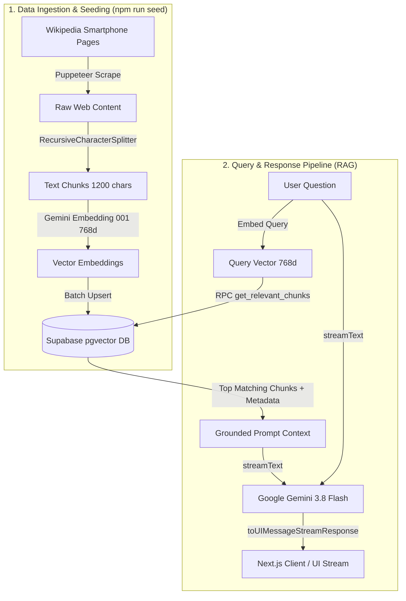

# 📱 PhoneGPT — AI Smartphone Assistant with RAG

[](https://nextjs.org/)
[](https://react.dev/)
[](https://www.typescriptlang.org/)
[](https://tailwindcss.com/)
[](https://supabase.com/)
[](https://ai.google.dev/)
[](https://sdk.vercel.ai/)

**PhoneGPT** is a modern, high-performance conversational AI assistant specialized in smartphones. Powered by **Retrieval-Augmented Generation (RAG)**, it combines automated web scraping with **Google Gemini 3.8 Flash** and **Supabase Vector (`pgvector`)** to deliver accurate, citation-backed answers about smartphone specs, release dates, hardware comparisons, and features.

---

## 🌟 Key Features

- **⚡ Real-Time Streaming Responses**: Instant, token-by-token streaming powered by Vercel AI SDK (`@ai-sdk/google` & `@ai-sdk/react`) and Gemini 3.8 Flash.
- **🔍 Vector Semantic Search (RAG)**: Uses `gemini-embedding-001` (768 dimensions) with Supabase's `pgvector` cosine similarity matching for context retrieval.
- **🕷️ Autonomous Ingestion Pipeline**: Headless scraping via **Puppeteer** and chunking with **LangChain's Recursive Character Text Splitter**.
- **🛡️ Quota & Rate-Limit Resilience**: Embedded exponential backoff and delay throttling specifically tuned to stay safely within Google Gemini's free-tier rate limits (15 RPM / 1,000 RPD).
- **🔄 Idempotent Data Seeding**: Smart skipping for already-indexed pages, with `--force` override flag when re-indexing is required.
- **📱 Focused Smartphone Persona**: Guardrails keep the model dedicated to smartphone inquiries, citing source references and dates while flagging ungrounded knowledge.
- **🎨 Sleek Responsive UI**: Built with Next.js 16 App Router, Tailwind CSS v4, Lucide icons, and GitHub-flavored markdown rendering (`react-markdown`).

---

## 🏗️ Architecture & Workflow



---

## 🛠️ Tech Stack

| Layer | Technology | Details |
| :--- | :--- | :--- |
| **Framework** | [Next.js 16 (App Router)](https://nextjs.org/) | Fast server-side rendering, API routes, and modern layout system |
| **Frontend** | [React 19](https://react.dev/), [TypeScript](https://www.typescriptlang.org/) | Type-safe component architecture |
| **Styling** | [Tailwind CSS v4](https://tailwindcss.com/), `@tailwindcss/typography` | Responsive layout, dark/light markdown styling |
| **AI Orchestration** | [Vercel AI SDK](https://sdk.vercel.ai/) (`ai`, `@ai-sdk/react`, `@ai-sdk/google`) | Streaming chat protocol, hooks (`useChat`), and vector embedding |
| **LLM & Embeddings** | [Google Gemini 3.8 Flash](https://ai.google.dev/) & `gemini-embedding-001` | High-speed generative answering & 768-dimensional vector generation |
| **Vector Database** | [Supabase](https://supabase.com/) (`pgvector`) | PostgreSQL vector similarity search using cosine distance (`<=>`) |
| **Scraping & Chunking** | [Puppeteer](https://pptr.dev/) & [LangChain](https://js.langchain.com/) | Headless browser extraction & recursive character chunk splitting |

---

## 📋 Prerequisites

Before setting up the project, ensure you have:

1. **Node.js**: `v20.x` or higher
2. **Package Manager**: `npm`, `yarn`, `pnpm`, or `bun`
3. **Google Gemini API Key**: Get a free key from [Google AI Studio](https://aistudio.google.com/)
4. **Supabase Account**: A free Supabase project from [supabase.com](https://supabase.com/)

---

## 🗄️ Supabase Database Setup

1. Open your Supabase Project dashboard.
2. Navigate to the **SQL Editor** in the left sidebar.
3. Paste and run the following script to enable `pgvector`, create the `chunks` table, add vector indexing, and install the matching function:

```sql
-- 1. Enable the pgvector extension to work with embedding vectors
create extension if not exists vector;

-- 2. Create the table for storing scraped chunks and their embeddings
create table if not exists chunks (
  id uuid primary key default gen_random_uuid(),
  content text not null,
  vector vector(768) not null,
  url text not null,
  date_updated timestamp with time zone default now()
);

-- 3. Create an index for fast cosine distance vector searches
create index if not exists chunks_vector_idx 
  on chunks 
  using ivfflat (vector vector_cosine_ops)
  with (lists = 100);

-- 4. Create the stored procedure function to query matching chunks
create or replace function get_relevant_chunks(
  query_vector vector(768),
  match_threshold float,
  match_count int
)
returns table (
  id uuid,
  content text,
  url text,
  date_updated timestamp,
  similarity float
)
language sql stable
as $$
  select
    id,
    content,
    url,
    date_updated,
    1 - (chunks.vector <=> query_vector) as similarity
  from chunks
  where 1 - (chunks.vector <=> query_vector) > match_threshold
  order by similarity desc
  limit match_count;
$$;
```

---

## 🚀 Quickstart Guide

### 1. Clone the Repository

```bash
git clone https://github.com/Imtiajul/phoneGpt-Rag.git
cd phoneGpt-Rag
```

*(If cloning into a subfolder, ensure you are inside `phonegpt-nextrag`)*

### 2. Install Dependencies

```bash
npm install
```

### 3. Configure Environment Variables

Create a `.env` file in the root directory by copying `example.env`:

```bash
cp example.env .env
```

Fill in your actual API keys:

```env
GEMINI_API_KEY=your_gemini_api_key_here
NEXT_PUBLIC_SUPABASE_URL=https://your-project-id.supabase.co
NEXT_PUBLIC_SUPABASE_ANON_KEY=your_supabase_anon_key_here
```

### 4. Seed the Vector Database

Populate your Supabase database with scraped smartphone specifications:

```bash
npm run seed
```

> **Note:** The seeder includes rate-limit protection (4.5s delays and exponential backoff) to respect the Gemini free-tier quota (15 RPM). Pages already indexed will automatically be skipped.
> 
> To force re-indexing of all pages, pass the `--force` flag:
> ```bash
> npm run seed -- --force
> ```

### 5. Launch the Development Server

```bash
npm run dev
```

Open [http://localhost:3000](http://localhost:3000) in your browser to start chatting with **PhoneGPT**!

---

## 📜 Available Scripts

| Command | Description |
| :--- | :--- |
| `npm run dev` | Starts the Next.js development server with hot-reload |
| `npm run build` | Builds the application for production deployment |
| `npm run start` | Runs the compiled production build |
| `npm run lint` | Runs ESLint to inspect code quality |
| `npm run seed` | Runs the Puppeteer crawler and populates Supabase with vector embeddings |
| `npm run seed -- --force` | Force re-crawls and re-indexes all target webpages |

---

## 📂 Project Structure

```text
phonegpt-nextrag/
├── src/
│   ├── app/
│   │   ├── api/
│   │   │   └── chat/
│   │   │       └── route.ts       # POST endpoint: RAG vector lookup + Gemini 3.8 Flash streaming
│   │   ├── favicon.ico
│   │   ├── globals.css            # Global Tailwind CSS v4 styling
│   │   ├── layout.tsx             # Root layout with Geist font configuration
│   │   └── page.tsx               # Main chat container with React Suspense
│   ├── components/
│   │   ├── ui/
│   │   │   ├── button.tsx         # Accessible button primitives
│   │   │   ├── ChatInput.tsx      # Form input bar and submit actions
│   │   │   ├── ChatOutput.tsx     # Message list with ReactMarkdown & streaming status
│   │   │   └── input.tsx          # Form input styling
│   │   ├── ChatBox.tsx            # Main stateful chat interface (useChat hook)
│   │   └── Footer.tsx             # Data attribution and Creative Commons license
│   ├── lib/
│   │   └── utils.ts               # Class name merging utility (cn)
│   ├── seed.ts                    # Ingestion script: Puppeteer scraper + LangChain splitter + Gemini embeddings
│   └── setupdb.sql                # Supabase SQL RPC vector match function
├── example.env                    # Template for environment variables
├── package.json                   # Project dependencies and npm scripts
├── tsconfig.json                  # TypeScript configuration
└── README.md                      # Documentation
```

---

## ⚙️ Customization & Knowledge Expansion

### Adding New Phones or Sources
To ingest specifications for additional phones, edit the URL array in [`src/seed.ts`](src/seed.ts):

```typescript
loadData([
  "https://en.wikipedia.org/wiki/Samsung_Galaxy_S25",
  "https://en.wikipedia.org/wiki/Samsung_Galaxy_S24",
  "https://en.wikipedia.org/wiki/IPhone_16",
  "https://en.wikipedia.org/wiki/IPhone_16_Pro",
  "https://en.wikipedia.org/wiki/Google_Pixel_9",     // Add custom device
  "https://en.wikipedia.org/wiki/Google_Pixel_9_Pro", // Add custom device
]);
```
Then run `npm run seed`.

### Adjusting Similarity Threshold & Context Window
In [`src/app/api/chat/route.ts`](src/app/api/chat/route.ts), you can fine-tune retrieval sensitivity:

```typescript
const { data, error } = await supabase.rpc("get_relevant_chunks", {
  query_vector: embedding,
  match_threshold: 0.5, // Lower for broader recall, raise for stricter precision
  match_count: 10,       // Number of context chunks fed to Gemini
});
```

---

## ⚖️ Attribution & License

- **Data Attribution**: Smartphone content is scraped from [Wikipedia](https://www.wikipedia.org/) and made available under the [Creative Commons Attribution-ShareAlike 4.0 International License (CC BY-SA 4.0)](https://creativecommons.org/licenses/by-sa/4.0/).
- **Project License**: Open-source under the [MIT License](LICENSE).
